<div align="center">


<br>

[](https://github.com/JAbarca74/PassRipple/actions/workflows/ci.yml)
[](https://github.com/JAbarca74/PassRipple/actions/workflows/security.yml)
[](https://github.com/JAbarca74/PassRipple/actions/workflows/codeql.yml)
[](https://scorecard.dev/viewer/?uri=github.com/JAbarca74/PassRipple)
<br>
[](LICENSE)
[](tsconfig.json)
[](workers/)
[](db/)
[](CONTRIBUTING.md)

**Device-bound QR tickets · Offline-first gate validation · SINPE Móvil payments · Verifiable payouts**

[Why](#why-passripple) · [How it works](#how-it-works) · [Invariants](#core-invariants) · [Architecture](#architecture) · [Getting started](#getting-started) · [Security](#security) · [Roadmap](#roadmap) · [Contributing](#contributing)

</div>

---

> [!NOTE]
> **Status: pre-alpha.** Phases 0 and 1 are complete: the database enforces invariants I1–I5 and Row Level Security, and tickets carry device-bound credentials that no gate device can forge (I7). Phase 2 is built and awaiting its field trial: the API on Cloudflare Workers, staff enrollment, gate manifests, offline batches and a gate app that validates without signal and loses nothing on a forced power-off (I6). Phase 3 (checkout, wallet, ticket recovery and buyer data erasure) is under construction.

## Why PassRipple

Organizers of mass events in Costa Rica sell paper tickets that get reprinted and resold as originals. At the gate, the copy looks exactly like the real one, and the fraud is only discovered when more people are inside than tickets were sold.

PassRipple starts from one idea:

<p align="center">
  
</p>

Every ticket is a unique record that is redeemed on its first scan, and its credential lives on the buyer's phone. Copying a ticket becomes pointless: a screenshot expires in seconds, and a second scan is rejected.

**Mission:** every person who buys a ticket gets in knowing it is real, and every organizer knows at any moment how many tickets were sold, how many people got in, and how much money is theirs, from a rural rodeo ring to a stadium.


## How it works

<p align="center">
  
</p>

| | |
|---|---|
| **Three taps to buy** | Open the event link, tap *Buy*, enter an email or phone, tap *Accept and pay with SINPE*. No account, no password. |
| **Device-bound credentials** | Each ticket is bound to a non-extractable key on the buyer's phone. The QR is re-signed every 30 seconds, so screenshots expire before they reach the gate. |
| **Offline-first gates** | Gate devices verify tickets locally with public keys only. A gate keeps working all night with no signal and syncs when it can. |
| **Verifiable payouts** | Every colón is recorded in an append-only ledger. Organizers see each payment live and confirm every payout. |
| **Built for oversight** | Live attendance against the permitted capacity, and an automatic post-event report for the municipality. |

### A gate never needs signal

Rural rodeo rings and full stadiums both lose coverage. Each gate device validates tickets on its own, writes every operation to an encrypted local outbox that survives a forced power-off, and syncs when the signal returns. Nothing recorded at the gate is lost or rejected (I6).

<p align="center">
  
</p>


## Core invariants

The rules the system must never break. They live in the database and in the cryptography, not in application code, and each one has a test that tries to violate it.

| # | Invariant | Enforced by |
|---|---|---|
| I1 | A public ticket is redeemed exactly once. | Database constraint + pgTAP |
| I2 | Committed tickets never exceed the event's permitted capacity. | Database constraint + pgTAP |
| I3 | Complimentary tickets never exceed the event's declared quota. | Database constraint + pgTAP |
| I4 | No payment is processed twice. | Database constraint + pgTAP |
| I5 | A sale's fee is frozen at the moment of the sale. | Database constraint + pgTAP |
| I6 | No operation recorded on a gate device is lost or rejected on sync. | Durable outbox + idempotent sync |
| I7 | No gate device can forge a valid credential. | Ed25519, public keys only at the gate |
| I8 | No third-party script runs where the buyer's keys or personal data live. | Separate origin + strict CSP |
| I9 | An organizer's payout never exceeds what their event collected, minus fees and refunds. | Append-only ledger (Phase 4) |


## Architecture

A **modular monolith**: domain modules with enforced boundaries, each owning its own database schema. Each module's `README.md` states what it does, what it owns, what it depends on, and what it must not do.

<p align="center">
  
</p>

| Layer | Technology |
|---|---|
| Language | TypeScript everywhere; SQL for invariants |
| Database | PostgreSQL on Neon, with Row Level Security |
| API and jobs | Cloudflare Workers, Hyperdrive, Queues, Cron Triggers |
| Web (site, checkout, wallet, dashboard) | Vite + React, served as Cloudflare Workers static assets |
| Gate app | Expo (React Native) with encrypted SQLite |
| Cryptography | Ed25519 and HMAC via `@noble/curves` and `@noble/hashes` |
| Tooling | pnpm workspaces, Biome, Vitest, pgTAP |

<details>
<summary><b>Repository layout</b></summary>

```
packages/            Core: pure, domain-agnostic libraries (level 0)
  contracts/         Shared schemas, types, domain events, QR format
  crypto/            Certificates, device-bound credentials, human codes
  pricing/           Fee calculation
  tax/               Municipal tax calculation
  bank-parsers/      Deterministic bank payment notice parsers
  outbox/            Durable offline queue

modules/             Domain modules (levels 1-4), each owning a schema
  identity/  jurisdictions/  events/  catalog/  privacy/           level 1
  inventory/  ticketing/  courtesy/  staff/                        level 2
  orders/  payments/  redemption/  manifest/  door-sales/          level 3
  settlement/  reporting/  notifications/  audit/                  level 4
  municipal/  seo/  analytics/  invoicing/

apps/                User-facing applications
  app/               Checkout, wallet, dashboard, municipal portal, admin
  site/              Public pages: events, organizers, legal
  scanner/           Gate app: validation, door sales, supervisor, inspector
  coordinator/       Optional LAN server for multi-gate events

workers/             Cloudflare Workers
  api/               HTTP API and composition root
  payments-in/       Bank payment notice receiver
  jobs/              Queues and scheduled tasks

db/                  Local database image, bootstrap SQL and its tests
scripts/             Boundary check, migrations and database tests
tools/sms-forwarder/ Android app that forwards bank SMS notices
```

</details>


## Getting started

Requirements: Node.js 22.18 or later, pnpm (through `corepack enable`), Docker, the PostgreSQL client (`psql`) and [pre-commit](https://pre-commit.com).

```bash
pre-commit install   # scan every commit for secrets
pnpm install

pnpm verify          # lint, type check, module boundaries and unit tests
pnpm test:cov        # Vitest unit tests with coverage

pnpm db:up           # start the local database (Docker)
pnpm db:migrate      # apply migrations in module dependency order
pnpm db:test         # run every pgTAP test
pnpm db:down         # stop the database and delete its data
```

Copy `.env.example` to `.env` and fill in local values; real secrets never go in the repository. To run the gate app on an Android emulator or phone, including airplane-mode tests, see [`apps/scanner/README.md`](apps/scanner/README.md).


## Security

PassRipple handles money and personal data, so security is designed in, not added on:

- Gate devices store **public keys only**. Extracting a gate device's data cannot produce a valid ticket.
- Payments are confirmed **only** by the bank's notice, parsed deterministically. Screenshots never approve a payment, and no AI model decides one.
- The system **cannot move money**. It calculates, records and reminds; transfers are made by a person.
- The checkout and wallet run on a separate origin with a strict CSP and **no third-party scripts**.
- Secrets never live in this repository. Every commit and the full history are scanned by gitleaks, every change is analyzed by Semgrep (with project-specific rules) and CodeQL, and Dependabot watches dependencies.
- Every GitHub Action is pinned to a full commit SHA, downloaded tools are checksum-verified, and the supply chain is graded by OpenSSF Scorecard.

> [!IMPORTANT]
> Found a vulnerability? **Do not open a public issue.** Report it privately through [GitHub's vulnerability reporting](https://github.com/JAbarca74/PassRipple/security/advisories/new). See [`SECURITY.md`](SECURITY.md).


## Roadmap

<p align="center">
  
</p>

<details>
<summary><b>What each phase delivers</b></summary>

- [x] **Phase 0** — Foundations: schema, Row Level Security, invariants I1–I5 under test, Neon
- [x] **Phase 1** — Cryptography: device-bound credentials (I7), human codes, device binding
- [ ] **Phase 2** — API on Cloudflare Workers with Hyperdrive, single-gate offline validator, Play Store closed testing, iOS build tested in the simulator
- [ ] **Phase 3** — Three-tap checkout, SINPE collection and reconciliation
- [ ] **Phase 4** — Dashboard, ledger and verifiable payouts (I9)
- [ ] **Phase 5** — Public site, SEO and analytics
- [ ] **Phase 6** — Load testing and waiting room
- [ ] **Phase 7** — Age ratings, complimentary tickets, door sales
- [ ] **Phase 8** — Municipal oversight portal
- [ ] **Phase 9** — Multi-gate events
- [ ] **Phase 10** — Cards, e-invoicing

</details>


## Contributing

Contributions are welcome, in English or Spanish. Start with [`CONTRIBUTING.md`](CONTRIBUTING.md), look for issues labeled [`good first issue`](https://github.com/JAbarca74/PassRipple/labels/good%20first%20issue), and ask anything in [Discussions](https://github.com/JAbarca74/PassRipple/discussions). Everyone taking part follows the [Code of Conduct](CODE_OF_CONDUCT.md).

If PassRipple is useful or interesting to you, starring the repository helps other people find it.

<a href="https://star-history.com/#JAbarca74/PassRipple&Date">
  <picture>
    <source media="(prefers-color-scheme: dark)" srcset="https://api.star-history.com/svg?repos=JAbarca74/PassRipple&type=Date&theme=dark">
    
  </picture>
</a>


## License

PassRipple is [fair source](https://fair.io), released under the [Functional Source License, Version 1.1, ALv2 Future License](LICENSE) (FSL-1.1-ALv2). You may read, run, modify and redistribute it for any purpose except offering a competing commercial product or service. Two years after each version is published, that version also becomes available under the Apache License 2.0.

"PassRipple" and its logo are trademarks of Jefferson Abarca and are not covered by the license.

---

<div align="center">

Made in Costa Rica 🇨🇷

</div>
